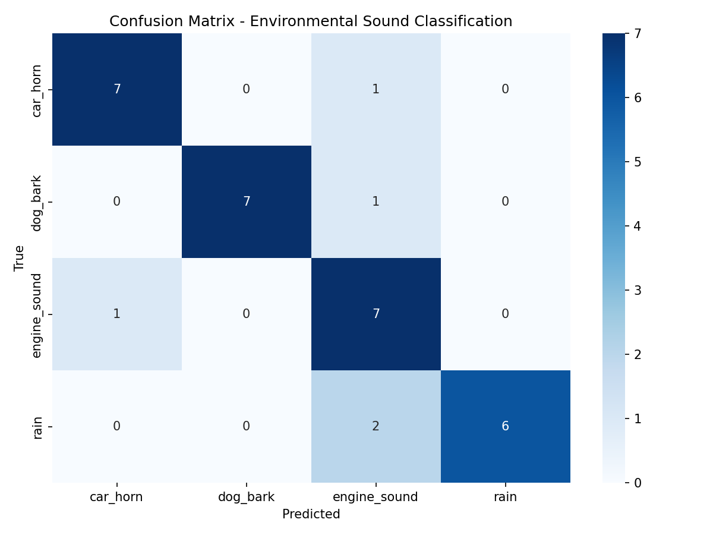
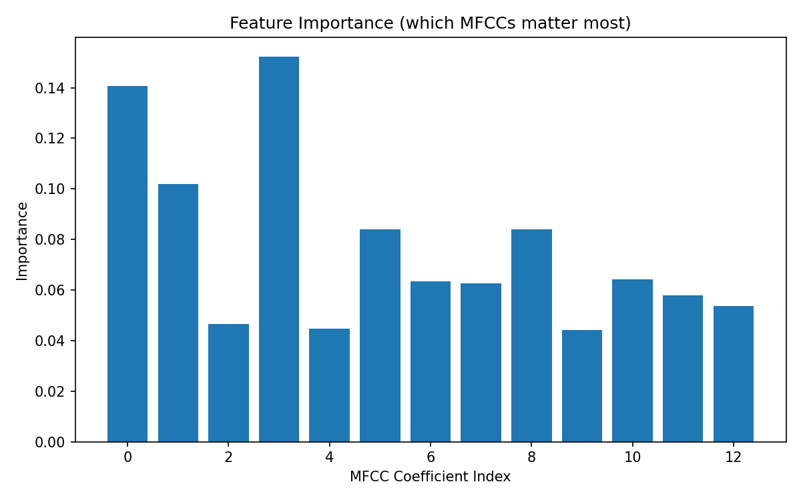

# Environmental Sound Classification Using Machine Learning

This project was developed for the GreenWave TechLabs Machine Learning Internship technical screening task.

## Objective

The objective is to classify environmental audio into four categories:

- Car Horn
- Dog Bark
- Engine Sound
- Rain

## Dataset

The project uses selected classes from the ESC-50 Environmental Sound Dataset.

The `sort_dataset.py` script reads the ESC-50 metadata and organises the selected audio files into class folders.

## Feature Extraction

The project uses 13 Mel-Frequency Cepstral Coefficients (MFCCs).

MFCCs were selected because they provide a compact representation of the frequency characteristics of audio and approximate how humans perceive sound.

## Model

A Random Forest Classifier with 200 decision trees was used.

Random Forest was selected because:

- It works well with MFCC features.
- It trains quickly on a standard laptop.
- It does not require a GPU.
- It provides feature importance.
- It is easy to explain and demonstrate.

## Model Evaluation

The final Random Forest model was evaluated on four environmental sound classes.

| Metric | Score |
|---|---:|
| Accuracy | 84.38% |
| Precision | 87.78% |
| Recall | 84.38% |
| F1-score | 85.06% |

### Class-wise Performance

| Sound Class | Precision | Recall | F1-score |
|---|---:|---:|---:|
| Car Horn | 88% | 88% | 88% |
| Dog Bark | 100% | 88% | 93% |
| Engine Sound | 64% | 88% | 74% |
| Rain | 88% | 62% | 73% |

The model was evaluated using accuracy, precision, recall, F1-score, and a confusion matrix.

### Confusion Matrix



### Feature Importance



## Bonus Features

- Data augmentation
- Noise robustness testing
- Real-time microphone prediction
- Streamlit web interface
- Confidence score display

## Installation

```bash
pip install -r requirements.txt

## How to Run

### Launch the Streamlit Web App

```bash
streamlit run app.py
```

### Predict a Saved Audio File

```bash
python predict_single_file.py
```

### Use Live Microphone Prediction

```bash
python predict_live_mic.py
```

### Retrain the Model

```bash
python audio_classifier.py
```
